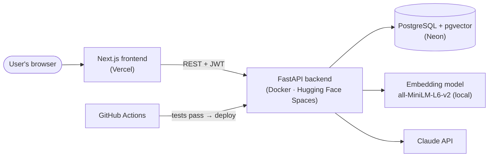
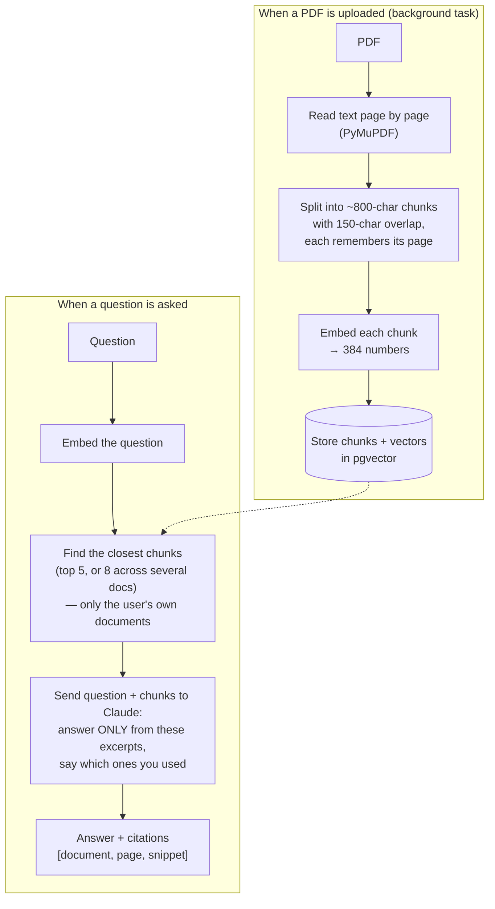

# DocuMind — AI Document Intelligence & PDF Assistant

[](https://github.com/RakeshreddyParimireddy/AI-Document-Intelligence-PDF-Assistant/actions/workflows/ci.yml)

Upload PDFs and **chat with them**: ask questions and get answers with **page-level citations**,
generate **summaries with key points**, and **extract structured data** (dates, names, amounts) into a table you can download as CSV — across one document or many.

**🔗 Live demo:** _add your Vercel link here_ · **🎬 Demo video:** _add your video link here_


---

## Features

- **Ask questions, get cited answers** — every answer shows clickable chips like `invoice.pdf · p. 2`; clicking one shows the exact source text.
- **Honest "not found"** — if the answer isn't in the documents, it says so instead of inventing one.
- **Multi-document chat** — pick several PDFs and ask one question across all of them.
- **Summaries** — a short summary plus key points, saved so reopening it is instant and free.
- **Field extraction** — type fields like *Invoice date* or *Total amount* → a table of value + page, downloadable as CSV.
- **Dashboard** — drag-and-drop upload with live status (processing → ready), stats cards, chat history.
- **Secure by default** — JWT login with bcrypt-hashed passwords; users only ever see their own documents; PDF-only uploads up to 20 MB.

## Screenshots

| Dashboard | Summary | Extract |
|---|---|---|
|  |  |  |

## Tech stack

| Part | Technology |
|---|---|
| Frontend | Next.js 16, React 19, TypeScript, Tailwind CSS 4 |
| Backend | Python 3.12, FastAPI, SQLAlchemy 2 |
| Database | PostgreSQL 16 + **pgvector** (HNSW index, cosine distance) |
| PDF parsing | PyMuPDF |
| Embeddings | sentence-transformers `all-MiniLM-L6-v2` (384-dim, runs locally — free) |
| LLM | Claude via the Anthropic SDK, with JSON-schema structured outputs |
| Auth | JWT (PyJWT) + bcrypt |
| Testing | pytest — 47 tests, LLM mocked, separate test database |
| DevOps | Docker, docker-compose, GitHub Actions CI/CD |
| Hosting | Vercel (frontend) · Hugging Face Spaces (backend) · Neon (database) |

## Architecture



### How a question is answered (RAG)



**Design decisions**

- **Search by meaning, not keywords** — "vacation days" finds a page that only says "annual leave".
- **Chunks never cross pages**, so every citation points at one exact page.
- **Structured outputs** — Claude replies in a fixed JSON schema (`found`, `answer`, `sources`); the backend checks every cited excerpt number, so a citation can never point at text that wasn't retrieved.
- **No retrieved text → no LLM call** — the app answers "not found" for free.
- **Summary and Extract read the whole document** (with page markers) instead of a few chunks, so nothing is missed; very long documents are cut with a visible note, never silently.
- **Page text lives in the database**, and the PDF file is deleted after processing — works on free hosting where files vanish on restart.
- **CSV export is formula-injection safe** (values starting with `=`, `+`, `-`, `@` are escaped).

## Run it locally

Requires **Docker Desktop** and **Node.js 20+**.

**1. Backend + database** (from the project folder):

```powershell
Copy-Item .env.example .env      # then edit the values in .env (set JWT_SECRET, and LLM_API_KEY for AI answers)
docker compose up --build -d
```

- Health check: http://localhost:8000/api/health
- Interactive API docs: http://localhost:8000/docs

If port 8000 is already in use, set `BACKEND_PORT=8001` in `.env` and use 8001 in the URLs.

**2. Frontend** (in a second terminal):

```powershell
cd frontend
Copy-Item .env.example .env.local   # set NEXT_PUBLIC_API_URL to the backend address
npm install
npm run dev
```

Open http://localhost:3000, create an account, and upload a PDF from `samples/`.

Stop the backend with `docker compose down` (add `-v` to also delete the database data).

> Without `LLM_API_KEY`, everything works except AI answers, summaries and extraction (they show a clear "AI is not configured" message).

## API

All routes except register/login need `Authorization: Bearer <token>`. Full interactive docs at `/docs`.

| Method | Route | What it does |
|---|---|---|
| POST | `/api/auth/register` · `/api/auth/login` | Create an account · get a JWT |
| GET | `/api/auth/me` | The logged-in user |
| POST | `/api/documents/upload` | Upload a PDF (max 20 MB), processed in the background |
| GET | `/api/documents` · `/api/documents/{id}` | My documents · one document's status |
| DELETE | `/api/documents/{id}` | Delete a document and everything about it |
| POST | `/api/documents/search` | Top matching chunks for a question (no LLM) |
| POST | `/api/chats` · GET `/api/chats` | New chat over chosen documents · my chats |
| GET | `/api/chats/{id}/messages` | Chat history |
| POST | `/api/chats/{id}/ask` | Question → answer + citations `[{document, page, snippet}]` |
| GET / POST | `/api/documents/{id}/summary` · `/summarize` | Saved summary · generate a new one |
| POST | `/api/documents/{id}/extract` | Field names → `[{field, value, page}]` |
| GET | `/api/dashboard/stats` | Documents, pages processed, questions asked |
| GET | `/api/health` | API + database + pgvector status |

## Tests

47 pytest tests cover auth, upload validation and processing, the chunker, vector retrieval,
RAG answers, summaries and settings. They use a separate `documind_test` database and a **fake LLM**,
so no API key is needed and nothing costs money.

```powershell
docker compose exec backend pytest -v
```

## CI/CD

On every push, GitHub Actions ([`ci.yml`](.github/workflows/ci.yml)):

1. runs all backend tests against a fresh PostgreSQL + pgvector database,
2. lints, builds and type-checks the frontend,
3. on `main`, once both pass, deploys the backend to Hugging Face Spaces. Vercel deploys the frontend.

## Deploy

Free deployment (Vercel + Hugging Face Spaces + Neon), step by step: see [DEPLOY.md](DEPLOY.md).

## Project structure

```
├── backend/
│   ├── app/
│   │   ├── main.py, config.py, database.py, models.py, schemas.py, auth.py
│   │   ├── routers/        auth · documents · chat · insights
│   │   └── services/       pdf_reader · chunker · embeddings · retriever · llm (all prompts)
│   ├── tests/              pytest suite (LLM mocked)
│   └── Dockerfile
├── frontend/
│   ├── app/                login · register · dashboard · documents/[id] · chats
│   ├── components/         Sidebar, UploadBox, ChatWindow, CitationChip, SummaryCard, ExtractTable, …
│   └── lib/                api.ts (all backend calls), useChatSession.ts
├── samples/                sample PDFs to try
├── docker-compose.yml
├── .github/workflows/ci.yml
└── PLAN.md · DEPLOY.md
```

## Security notes

- Secrets (database URL, JWT secret, API key) come only from environment variables; `.env` is git-ignored.
- Passwords are hashed with bcrypt; login errors don't reveal whether an email exists.
- Every document, chat and search is filtered by the logged-in user; other users' items return 404.
- Uploads: `.pdf` only, checked by file signature, 20 MB limit, read in 1 MB pieces.
- The backend container runs as a non-root user; CI has read-only repository access.
